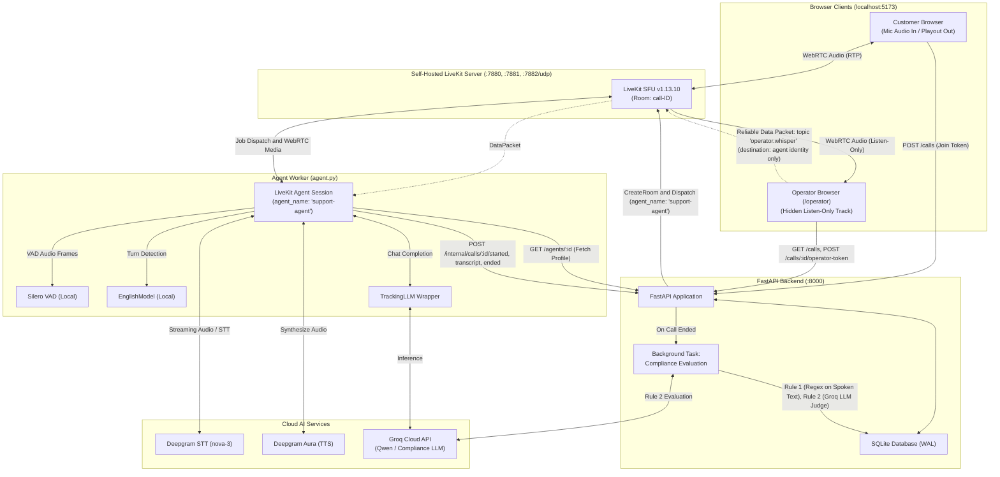

# Operator-Guided Voice AI Agent

## 1. Overview

An operator-guided voice AI agent system running on **self-hosted LiveKit server v1.13.10** (not LiveKit Cloud). The system allows a customer to converse with an AI voice agent with real-time barge-in support, enables a human operator to silently listen to the live call and inject guidance whispers directly into the agent's LLM context without alerting the customer, records full synchronized call transcripts, and runs post-call compliance evaluation.

### Technology Stack
- **LiveKit Server (`infra/`)**: Self-hosted LiveKit SFU v1.13.10 deployed via Docker Compose on local loopback.
- **FastAPI Backend (`api/`)**: Python service with SQLite storage (WAL mode), call lifecycle management, LiveKit room creation, token issuance, transcript persistence, and post-call compliance verification.
- **Voice Agent Worker (`agent/`)**: Python service powered by `livekit-agents 1.8.8`, Deepgram STT (`nova-3`), Groq LLM (`qwen/qwen3.8-27b`), Deepgram TTS (`aura-2-andromeda-en`), Silero VAD, and local neural turn detection (`EnglishModel`).
- **Web Client (`web/`)**: React 18 + Vite + TypeScript application providing dedicated Customer Call (`/`) and Operator Supervision (`/operator`) interfaces.

---

## 2. Architecture Diagram

The system coordinates WebRTC media, asynchronous dispatch jobs, data channel packets, and HTTP REST APIs across five primary boundaries:



### Key Architectural Mechanisms
1. **Explicit Dispatch via `agent_name="support-agent"`**: Rooms are provisioned by the API with an explicit agent dispatch. The worker registers for `"support-agent"` rather than auto-joining every room.
2. **Hidden Listen-Only Operator**: Operators receive tokens with `hidden: true` and `can_publish: false`. The customer never sees the operator in the participant list or track roster.
3. **Targeted Operator Whisper Data Channel**: Operators broadcast text guidance over LiveKit's reliable data channel under topic `"operator.whisper"`, addressing only the agent's identity (`destination_identities=[agent_identity]`). The agent injects this as a `system`-role message into `chat_ctx` without mentioning "whisper" or "operator" to the LLM.
4. **Post-Call Compliance Evaluation**: When the customer hangs up, the agent awaits pending transcript writes, posts `POST /internal/calls/{id}/ended`, and the backend initiates deterministic (Rule 1) and LLM-based (Rule 2) compliance checks.

---

## 3. Setup from Scratch

### Prerequisites
- macOS (Apple Silicon / Intel) or Linux
- Docker Desktop or Docker Engine with Docker Compose v2+
- Python 3.12 (managed via [`uv`](https://github.com/astral-sh/uv))
- Node.js 20+

### 1. Environment Keys
Copy [.env.example](.env.example) to `.env` in the repository root:
```bash
cp .env.example .env
```
Ensure your `.env` contains valid credentials:
```dotenv
# LiveKit Server Configuration (Self-Hosted)
LIVEKIT_URL=ws://localhost:7880
LIVEKIT_API_KEY=devkey
LIVEKIT_API_SECRET=secret

# Voice Pipeline Providers (Deepgram STT/TTS + Groq LLM)
DEEPGRAM_API_KEY=your_deepgram_api_key_here
GROQ_API_KEY=your_groq_api_key_here

# Database Configuration
DATABASE_PATH=./voice_agent.db

# Internal API Authentication (shared between api and agent worker)
INTERNAL_API_TOKEN=your_internal_api_token_here
API_BASE_URL=http://localhost:8000

# CORS Configuration (Must be http://localhost:5173)
CORS_ORIGINS=http://localhost:5173

# Frontend Web Client
VITE_API_BASE_URL=http://localhost:8000
```

### 2. Install Dependencies
```bash
# Sync Python virtual environments
uv --directory api sync
uv --directory agent sync

# Install frontend dependencies
cd web && npm install && cd ..
```

### 3. Run Order (4 Dedicated Terminals)

Launch the following four commands in separate terminal windows:

#### Terminal 1: Self-Hosted LiveKit Server
```bash
docker compose --env-file .env -f infra/docker-compose.yml up
```

#### Terminal 2: FastAPI Backend Service
```bash
uv --directory api run uvicorn app.main:app --port 8000
```

#### Terminal 3: Voice Agent Worker
```bash
cd agent && uv run python agent.py dev
```

#### Terminal 4: Web Client
```bash
cd web && npm run dev
```

> **IMPORTANT**:
> - Always access the web client at **`http://localhost:5173`** (do not use `127.0.0.1:5173`). The API CORS policy explicitly permits `http://localhost:5173`.
> - Wear **headphones** during live testing to prevent acoustic feedback loops where the microphone picks up speaker output and interrupts the agent.

### 4. Operator Page & Compliance Verification
- **Customer Call Interface**: Visit `http://localhost:5173` to start a customer session.
- **Operator Supervision Interface**: Open `http://localhost:5173/operator` in another tab to observe live active calls, listen to customer/agent audio, and type operator whispers.
- **Verify Compliance Result**: Once a call has ended, query the backend call record:
  ```bash
  curl -s http://localhost:8000/calls/<call_id> | jq .compliance
  ```
  Example compliance payload:
  ```json
  {
    "recording_disclosure": {
      "passed": true,
      "evidence_seq": 0,
      "offset_seconds": 1.5,
      "reason": "Agent announced recording notice within 1.5s of call start (limit: 30.0s)"
    },
    "refund_policy": {
      "passed": true,
      "reason": "Agent complied with refund restriction policy.",
      "attempts": 1
    }
  }
  ```

---

## 4. Ports Table

### Raw Infrastructure Configuration

From [`infra/docker-compose.yml`](infra/docker-compose.yml):
```yaml
ports:
  # HTTP API & WebSocket signalling
  - "7880:7880"
  # ICE-over-TCP fallback
  - "7881:7881"
  # WebRTC media traffic (single-port UDP mux)
  - "7882:7882/udp"
```

From [`infra/livekit.yaml`](infra/livekit.yaml):
```yaml
port: 7880

rtc:
  tcp_port: 7881
  udp_port: 7882
  use_external_ip: false
  node_ip: 127.0.0.1
```

### Port Details & Tradeoffs

| Port / Protocol | Service / Function | Configuration Details & Tradeoffs |
| :--- | :--- | :--- |
| **`7880/tcp`** | HTTP REST & WebSocket Signalling | Handles room management API requests, participant token authentication, and WebRTC SDP offer/answer signalling over WebSocket (`port: 7880`). |
| **`7881/tcp`** | ICE-over-TCP Fallback Transport | Configured via `rtc.tcp_port: 7881`. Transports WebRTC media over TCP when client firewalls or proxies block UDP traffic. |
| **`7882/udp`** | WebRTC Media Traffic (Single-Port UDP Mux) | Configured via `rtc.udp_port: 7882`. single port = simpler firewall/NAT rules, tradeoff = one socket, range = more sockets. |
| **`node_ip: 127.0.0.1`** | ICE Host Candidate | Explicitly set via `rtc.node_ip: 127.0.0.1` and `rtc.use_external_ip: false` in `livekit.yaml`. Advertises `127.0.0.1` so the local host browser routes media to Docker port forwards. (Localhost only; real-world production requires a public IP/TURN). |
| **`8000/tcp`** | FastAPI Backend Service | Hosts agent CRUD, call session provisioning, internal token-gated worker sync, and compliance inspection. |
| **`5173/tcp`** | Vite Dev Server | Hosts React client application for Customer and Operator views. |

---

## 5. Measured Latency

Latency metrics are captured directly from live session logs using `livekit-agents` pipeline events, monotonic clocks, and the [`agent/scripts/latency_report.py`](agent/scripts/latency_report.py) reporting tool.

Evidence documents:
- [docs/latency-report-final.txt](docs/latency-report-final.txt) (Final benchmark run, N=24 conversational turns across 3 calls)
- [docs/latency-report-before-aec.txt](docs/latency-report-before-aec.txt) (Baseline run before AEC warmup adjustment, N=16 conversational turns)
- [docs/latency-outliers.txt](docs/latency-outliers.txt) (Isolated outlier turns with total latency >= 3.3 s)

### Conversational Turn Latency (Excluding Greeting, N = 24 turns, 3 calls, 4 interrupted turns)
Copied directly from [docs/latency-report-final.txt](docs/latency-report-final.txt):

| Stage | Metric Label | Min (ms) | Median (ms) | P95 (ms) | Max (ms) |
|---|---|---|---|---|---|
| User Stopped -> STT Final | `transcription_delay` (framework-clamped) | 0.0 ms (N=24) | 379.9 ms (N=24) | 551.0 ms (N=24) | 791.7 ms (N=24) |
| STT Final -> LLM 1st Token | `llm_node_ttft` (duration / raw delta) | -311.9 ms (N=24) | 200.4 ms (N=24) | 2476.8 ms (N=24) | 3664.9 ms (N=24) |
| LLM 1st Token -> TTS 1st Audio Buffer | `tts_node_ttfb` / `llm_to_tts` (LLM 1st token -> TTS 1st audio) | 294.2 ms (N=24) | 336.9 ms (N=24) | 2405.1 ms (N=24) | 3629.9 ms (N=24) |
| TTS 1st Audio -> Audio Published | `playback_latency` (derived) | 0.1 ms (N=24) | 0.3 ms (N=24) | 0.9 ms (N=24) | 1.4 ms (N=24) |
| **Headline: User Stopped -> Audio Published** | **`e2e_latency` (headline)** | **902.8 ms (N=24)** | **1026.3 ms (N=24)** | **3459.9 ms (N=24)** | **4355.7 ms (N=24)** |

- preemptive_used flagged on 1 of 24 turns; on that turn the LLM first token preceded the STT final timestamp.
- Interrupted turns: 4 turns
- Note on artifact labeling: [docs/latency-report-final.txt](docs/latency-report-final.txt) still labels the `llm_to_tts` column "TTS Start -> TTS 1st Audio Buffer" (script line 189).

### Initial Greeting Playout (N = 3 calls)
Copied directly from [docs/latency-report-final.txt](docs/latency-report-final.txt):

| Metric | Min (ms) | Median (ms) | P95 (ms) | Max (ms) |
|---|---|---|---|---|
| Join -> First Greeting Audio | 2957.7 ms (N=3) | 3069.4 ms (N=3) | 3072.6 ms (N=3) | 3073.0 ms (N=3) |

### Interruption Latency (N = 3 barge-ins)
Copied directly from [docs/latency-report-final.txt](docs/latency-report-final.txt):

| Stage | Min (ms) | Median (ms) | P95 (ms) | Max (ms) |
|---|---|---|---|---|
| User Speech Onset -> Interruption Event | 1886.9 ms (N=3) | 1936.6 ms (N=3) | 2660.2 ms (N=3) | 2740.7 ms (N=3) |
| Interruption Event -> Playout Stop (estimated) | 2.2 ms (N=3) | 3.9 ms (N=3) | 5.2 ms (N=3) | 5.3 ms (N=3) |
| Total Interruption Latency | 1892.2 ms (N=3) | 1940.4 ms (N=3) | 2662.6 ms (N=3) | 2742.9 ms (N=3) |

### Before vs. After AEC Warmup Barge-In Comparison
Comparison of barge-in onset-to-event latency before and after configuring `aec_warmup_duration=0.5`:

| Benchmark Run | AEC Warmup Duration | Samples | Min (ms) | Median (ms) | Max (ms) |
|---|---|---|---|---|---|
| Baseline ([docs/latency-report-before-aec.txt](docs/latency-report-before-aec.txt)) | Default 3.0 s | N = 6 | 1191.3 ms (N=6) | 2344.4 ms (N=6) | 3603.3 ms (N=6) |
| Post-Fix ([docs/latency-report-final.txt](docs/latency-report-final.txt)) | Configured 0.5 s | N = 3 | 1886.9 ms (N=3) | 1936.6 ms (N=3) | 2740.7 ms (N=3) |

> **Evaluation of AEC Warmup Tuning**:
> The warmup configuration change did not yield a clear win. While the median decreased from 2344.4 ms to 1936.6 ms, the minimum latency worsened (from 1191.3 ms to 1886.9 ms). Given the tiny sample sizes (N=6 and N=3), this variance is inconclusive, and the root cause of the remaining ~1.9–2.7 s barge-in onset delay remains unisolated.

### Slow Turns (Tail Latency >= 3.3 s)
Four of 24 turns (17%) exceeded 3.3 s total latency. The raw log records are captured in [`docs/latency-outliers.txt`](docs/latency-outliers.txt):

| Call ID (First 8) | Turn Idx | Total Latency (ms) | Slowest Stage | Stage Latency (ms) |
|---|---|---|---|---|
| `392b22a7` | 5 | 3484.8 ms (N=1) | STT Final -> LLM 1st Token (`stt_to_llm`) | 2816.0 ms (N=1) |
| `600ebfcd` | 7 | 3318.9 ms (N=1) | LLM 1st Token -> TTS 1st Audio Buffer (`llm_to_tts`) | 2756.1 ms (N=1) |
| `600ebfcd` | 11 | 4355.7 ms (N=1) | STT Final -> LLM 1st Token (`stt_to_llm`) | 3664.9 ms (N=1) |
| `596459e8` | 7 | 3318.2 ms (N=1) | LLM 1st Token -> TTS 1st Audio Buffer (`llm_to_tts`) | 3629.9 ms (N=1) |

- 4 of 24 turns (17%) took >= 3.3 s.
- 2 spikes occurred in STT Final -> LLM 1st Token (2816.0 ms and 3664.9 ms).
- 2 spikes occurred in LLM 1st Token -> TTS 1st Audio Buffer (2756.1 ms and 3629.9 ms); the delay could be the LLM streaming its first sentence or TTS start-up; cause not isolated.
- Note on turn `596459e8`/7: the stage value (3629.9 ms) exceeds the turn total (3318.2 ms) because the LLM first token preceded the VAD end-of-speech timestamp (preemptive generation).
- No HTTP 429, retry, or timeout lines were logged during these turns; cause not isolated.

### Metric Provenance & Measurement Caveats
- **`transcription_delay`**: framework-clamped (see agent.py:251-254).
- **`tts_node_ttfb` / `llm_to_tts` (LLM 1st Token -> TTS 1st Audio)**: measures LLM-first-token -> TTS-first-audio (see agent.py:284-285); the delay could be the LLM streaming its first sentence or TTS start-up; cause not isolated.
- **Negative STT -> LLM Delta**: The minimum STT-to-LLM value (-311.9 ms) is a raw delta artifact resulting from preemptive LLM generation where token generation commenced prior to final STT commitment. It is consistent with preemptive generation but unproven.
- **Headline Starts at VAD End-of-Speech**: Headline end-to-end latency begins at VAD end-of-speech (after silence calculation), and thus inherently includes endpointing wait duration.
- **Playout Stop**: event -> stop is a software-side estimate (agent.py:194-199) and may reflect handler time only, not audible silence.

---

## 6. Design Decisions

1. **Rule 1 Deterministic Compliance (Recording Notice)**:
   - Evaluated without an LLM using Python regex matching on spoken text (`spoken_text` from barge-in synchronized lines).
   - Requires call/conversation recording context in the same sentence (e.g., matching `"call is recorded"`, rejecting `"recording your complaint"`).
   - Enforces regex negative lookbehind to reject negation (e.g., `"this call is not being recorded"`).
   - Validates that playback start of the recording notice occurs within 30.0 s of server-side customer join (`customer_joined_at`).
2. **Rule 2 Fail-Closed LLM Compliance Judge (Refund Policy)**:
   - Evaluates whether the agent promised a refund using Groq LLM (`qwen/qwen3.8-27b`) at temperature 0.0.
   - Treats call transcripts strictly as untrusted data inside a structured prompt.
   - Retries up to 3 times on invalid JSON or ungrounded evidence substrings; falls back cleanly without crashing.
   - Status transitions fail-closed: if the model fails or produces invalid JSON repeatedly, the compliance status is marked `"error"`.
3. **Fail-Closed Operator Whispering**:
   - The operator sends messages over LiveKit's reliable data channel under topic `"operator.whisper"`.
   - The agent inspects `DataPacket.participant`. If the sender is not a hidden participant (`dp.participant is not None`), the packet is discarded.
   - Whisper text is injected into `chat_ctx` as an internal `system` prompt instructing the agent to follow guidance naturally without quoting the supervisor.
   - Whisper metadata is never logged or exposed to the customer WebRTC channel.
4. **Local Turn Detector & VAD Interruption (Zero Cloud Gateway Calls)**:
   - The default `livekit-agents` turn detector attempts to contact `agent-gateway.livekit.cloud`, generating HTTP 401 warnings on self-hosted servers and introducing ~4.6 s barge-in fallback delays.
   - The agent explicitly configures local `EnglishModel` turn detection and `InterruptionOptions(mode="vad")`.
   - Verified: `agent.log` contains zero calls to `agent-gateway.livekit.cloud`.

---

## 7. Known Limitations & Next Steps

### Known Limitations
- no auth on public API (POC)
- Groq model list lacks llama-3.x
- room empty_timeout 60s
- one call = one dispatch
- single UDP port
- barge-in truncation and playout stop estimated
- barge-in onset->event ~2 s, not isolated (target <700 ms)
- browser playout/jitter buffer not measured (localhost, no network RTT)
- preemptive_used and whisper_in_ctx are heuristics
- transcription_delay clamped
- system-role whisper risk (user-role fallback unused)
- no TURN
- LLM judge borderline cases (e.g. "To process the refund..." passes)
- stale "pending" compliance after API restart
- no-end if agent crashes
- Rule 1 uses line playback start
- hang-up truncation emits an [INTERRUPTION_DEBUG] line that is not a barge-in
- turn-detector plugin and dev-mode deprecation warnings
- log lines duplicated 2-3x
- false-interruption resume (2.0 s) enabled
- VAD barge-in with echo risk on speakers (aec_warmup_duration=0.5 suits headphones only)
- Tail latency: 4 of 24 turns (17%) exceeded 3.3 s due to LLM or TTS time-to-first-byte spikes; provider-side vs network cause not isolated.

### Next Steps
- trace VAD speech-start to interruption event path
- real AEC / speakers
- TURN server
- multi-worker scaling and load test
- auth
- supervisor-tuned compliance rules
- retry/recovery for stale pending
- per-turn provider timing plus retry/fallback (secondary LLM/TTS) and a tighter timeout
